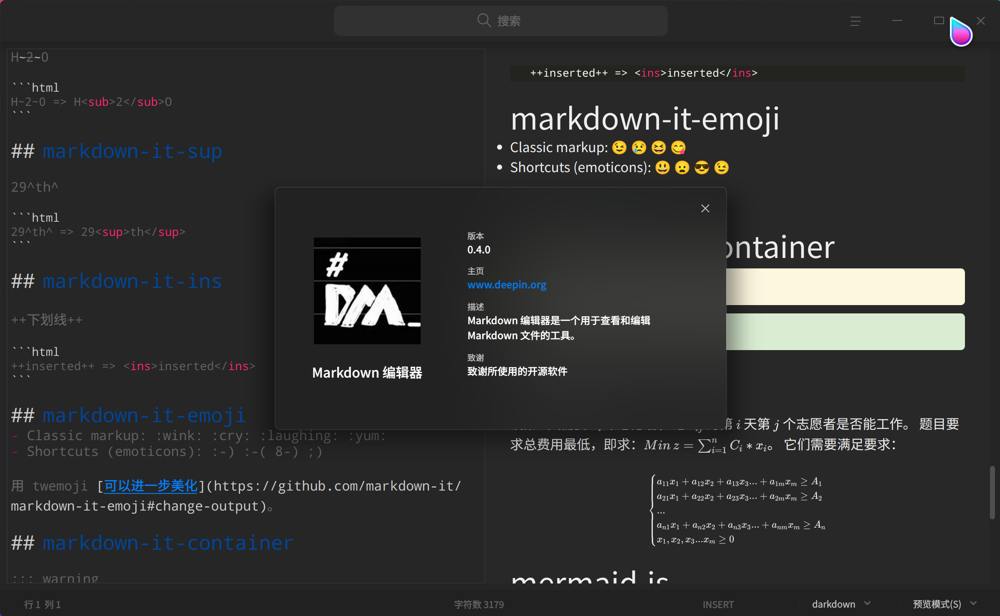
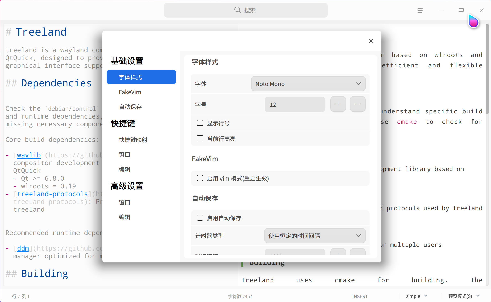

# DMarked

A Markdown editor built with DTK.

> **Important update v0.4.0**: DMarked has been migrated to Qt6 and DTK6.

Project links: [DMarked (GitHub)](https://github.com/DMarked/DMarked) & [Gitee](https://gitee.com/rewine/DMarked)

Forum post: [https://bbs.deepin.org/en/post/228829](https://bbs.deepin.org/en/post/228829)

For Chinese documentation, see [README.zh_CN.md](README.zh_CN.md).

## Highlights

- Two-pane editing with live preview and switchable read/write/preview modes
- Full Markdown extension support: Mermaid, KaTeX, highlight.js, markdown-it
- Export to PDF/HTML and batch conversion via CLI
- Theme switching, character counting, and cursor position display
- Persistent configuration and settings panel (font, shortcuts, autosave, etc.)
- Qt6 / DTK6 support

## Screenshots

Main interface



Settings interface example



## UI Modes

You can switch Markdown themes from the bottom info bar.

Available modes:

- Read Mode: only the right preview pane
- Write Mode: only the left editor pane
- Preview Mode: edit and preview side by side
- Preview Mode S: editor and preview scrolling are synchronized (algorithm still being improved)
- Preview Mode N: editor and preview scroll independently

## Command Line

```bash
$ dmarked -h
Usage: dmarked [options] source [destination]

Options:
  -h, --help                Show this help.
  -v, --version             Show version information.
  -w, --write <file>        Open a markdown file in DMarked
  -f, --format <pdf>        Convert markdown files to pdf/html
  -L, --use-landscape       Set landscape orientation (default is portrait)
  -s, --page-size <A4>      Set page size, e.g. A4, Letter
  -l, --margin-left <10>    Set left margin (pt)
  -t, --margin-top <10>     Set top margin (pt)
  -r, --margin-right <10>   Set right margin (pt)
  -b, --margin-bottom <10>  Set bottom margin (pt)
  -d, --max-depth <1>       Max depth for batch conversion

Arguments:
  source                    Source file or directory
  [destination]             Output file or directory
```

The CLI mode was designed mainly for batch conversion, and that goal has mostly been achieved.

Convert `a.md` to `my.html`:

```bash
dmarked -f html a.md my.html
```

Convert all Markdown files in the current directory and up to 2 levels of subdirectories to PDF. The `-s` options are the same as in the GUI page-size selector. The theme follows the last-used GUI theme.

If `destination` is omitted, exported PDFs are placed alongside the source md files.

```bash
dmarked -f pdf -s A5 -t 20 -b 20 -d 3 .
```

Convert all md files in `content` (excluding subdirectories) to PDF and write them into `content_pdf`:

```bash
dmarked -f pdf content content_pdf
```

## Dependencies

On Debian/Deepin, install build dependencies with:

```bash
sudo apt install qt6-base-dev qt6-svg-dev libdtk6widget-dev libdtk6gui-dev libdtk6core-dev qt6-webengine-dev qt6-5compat-dev cmake
```

## Clone Source

```bash
git clone --recurse-submodules git@github.com:DMarked/DMarked.git
cd DMarked
```

If the repository is already cloned, initialize/update submodules with:

```bash
git submodule update --init --recursive
```

## Build and Install (CMake)

```bash
cmake -S . -B build -DCMAKE_BUILD_TYPE=Release
cmake --build build -j
sudo cmake --install build
```

## License

DMarked is licensed under GPLv3.

## Third-party Libraries

| Category | Project | License |
| --- | --- | --- |
| Core | [qmarkdowntextedit](https://github.com/pbek/qmarkdowntextedit) | MIT |
| Core | [markdown-it](https://github.com/markdown-it/markdown-it) | MIT |
| Core | [And More](https://github.com/wineee/DMarked/tree/main/resources/3rdscripts) | - |
| Theme | [wecatch/markdown-css](https://github.com/wecatch/markdown-css) | MIT |
| Theme | [yrgoldteeth/darkdowncss](https://github.com/yrgoldteeth/darkdowncss) | - |
| Theme | [kevinburke/markdown-css](https://bitbucket.org/kevinburke/markdowncss) | Apache V2.0 |
| Theme | [CuteMarkEd-NG's Theme](https://github.com/Waqar144/CuteMarkEd-NG) ([LICENSE](https://github.com/Waqar144/CuteMarkEd-NG/blob/develop/LICENSE.md)) | - |
| Reference | [deepin-editor](https://github.com/linuxdeepin/deepin-editor) | GPL-3.0 |
| Reference | [WebEngine Markdown Editor Example](https://doc.qt.io/qt-5/qtwebengine-webenginewidgets-markdowneditor-example.html) | BSD |

Organization's profile picture @[RigoLigo](https://github.com/RigoLigoRLC)
